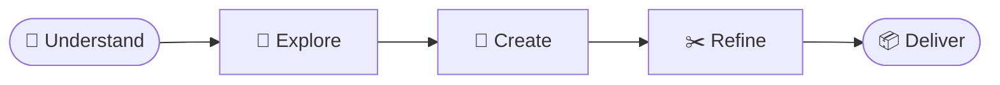

<!-- Header -->
<p align="center">
  
</p>

<!-- Typing SVG -->
<p align="center">
  <a href="https://nexus-sumit.vercel.app">
    
  </a>
</p>

<!-- Links -->
<p align="center">
  <a href="https://nexus-sumit.vercel.app"></a>
  <a href="https://github.com/Sumit0802-afk/nexus_sumit"></a>
  <a href="#-quick_start"></a>
  <a href="#-contact"></a>
</p>

<p align="center">
  
  
  
  
  
</p>

<br>

<!-- At a glance -->
<table align="center">
  <tr>
    <td align="center" width="25%" valign="top">
      <h3>🖼️</h3>
      <b>Posters</b><br>
      <sub>Event, campaign and experimental posters</sub>
    </td>
    <td align="center" width="25%" valign="top">
      <h3>📱</h3>
      <b>Social creatives</b><br>
      <sub>Recruitment drives, festive greetings and tributes</sub>
    </td>
    <td align="center" width="25%" valign="top">
      <h3>🎟️</h3>
      <b>Events</b><br>
      <sub>Hackathons, workshops and meet-ups</sub>
    </td>
    <td align="center" width="25%" valign="top">
      <h3>🌐</h3>
      <b>Web and brand</b><br>
      <sub>Website design and brand identity</sub>
    </td>
  </tr>
</table>

<br>

<blockquote align="center">
  <b>Clarity. Creativity. Consistency. Impact.</b>
</blockquote>

<!-- How the work is made -->


<br>

<!-- About -->
## `> about.js`

```javascript
const portfolio = {
    name: "Sumit Bhamu",
    role: "Graphic Designer & Visual Creator",
    liveSite: "https://nexus-sumit.vercel.app",
    pages: ["the portfolio", "the Dark Art collection"],
    sections: ["Hero", "About", "Work", "Process", "Approach", "Expertise", "Experience", "Contact"],
    work: ["posters", "social media creatives", "event creatives", "digital design", "website design"],
    tools: ["Canva", "Photoshop", "Illustrator", "Figma", "Premiere Pro", "After Effects"],
    experience: "Graphic Designer, Creative Team, Team Next Nexus (TNN), VIT-AP University",
    builtWith: ["HTML", "CSS", "JavaScript"],   // no frameworks, no build tools
    fonts: ["Cormorant Garamond", "EB Garamond", "Courier Prime"]
};
```

<p align="center">
  
</p>

<!-- Tech Stack -->
## `> tech_stack`

<p align="center">
  <a href="https://skillicons.dev">
    
  </a>
</p>

<p align="center">
  
</p>

<!-- Features -->
## `> features`

<table align="center">
  <tr>
    <td width="33%" valign="top">
      🎬 &nbsp;<b>Opening sequence</b><br>
      <sub>A cinematic entrance on the first visit, a brisk one after that</sub>
    </td>
    <td width="33%" valign="top">
      🔁 &nbsp;<b>Replay</b><br>
      <sub>Play the entrance again from the footer, or press R</sub>
    </td>
    <td width="33%" valign="top">
      🖱️ &nbsp;<b>Custom cursor</b><br>
      <sub>A smooth follower that reacts to work and links, on desktop</sub>
    </td>
  </tr>
  <tr>
    <td valign="top">
      🗂️ &nbsp;<b>Work filters</b><br>
      <sub>All, Posters, Social, Events, Digital and Website</sub>
    </td>
    <td valign="top">
      📖 &nbsp;<b>Case studies</b><br>
      <sub>Each piece opens with its client, category and story</sub>
    </td>
    <td valign="top">
      ⌨️ &nbsp;<b>Keyboard friendly</b><br>
      <sub>Open a piece with Enter or Space</sub>
    </td>
  </tr>
  <tr>
    <td valign="top">
      🌑 &nbsp;<b>Dark Art collection</b><br>
      <sub>A separate gallery page of surreal gothic artwork</sub>
    </td>
    <td valign="top">
      🧘 &nbsp;<b>Reduced motion</b><br>
      <sub>Animations step aside when the device asks for less motion</sub>
    </td>
    <td valign="top">
      📱 &nbsp;<b>Responsive</b><br>
      <sub>One page that fits phones, tablets and desktops</sub>
    </td>
  </tr>
</table>

<details>
<summary><b>The work on show</b></summary>
<br>

| Kind | Pieces |
| :--- | :--- |
| **Events** | Quantix 24hr Hackathon, Hackathon: Build the System, Java Jumpstart 2.0 and 3.0, Hyper Loop, Meet & Greet (TNN × AIBPT), V-TAPP × TNN |
| **Recruitment** | Join Team Next Nexus, Hiring Now, We Are Hiring, We Are Recruiting, Now Hiring: Freshers, Madhya Bharat |
| **Festive and tribute** | Happy Dussehra, Eid al-Fitr Mubarak, Dr. APJ Abdul Kalam |
| **Posters and artwork** | अहसास: Stay संस्कारी, Some Mysteries Are Meant to Remain Unseen, Yung DSA, Marwar |
| **Campaign studies** | PRIME × KSI: a style exploration, not client work |
| **Web and brand** | Falcon: website design and brand identity |

</details>

<p align="center">
  
</p>

<!-- Quick Start -->
## `> quick_start`

**You need:** a browser. Nothing to install and nothing to build.

```bash
# 1. clone
git clone https://github.com/Sumit0802-afk/nexus_sumit.git
cd nexus_sumit/sumit-portfolio

# 2. open index.html in a browser, or serve the folder  ->  http://localhost:3000
npx serve .
```

<p align="center">
  
</p>

<!-- Architecture -->
## `> architecture`

```
nexus_sumit/
└── sumit-portfolio/
    ├── index.html             the portfolio: every section on one page
    ├── styles.css             colours, type, layout and animation
    ├── script.js              entrance, cursor, work filters and case studies
    ├── dark-art.html          the Dark Art collection
    ├── dark-art.css           its styles
    ├── dark-art.js            its gallery
    ├── assets/                the artwork and photographs
    └── vercel.json            clean addresses, without .html
```

| To change | Edit |
| :--- | :--- |
| **Words and sections** | `index.html` |
| **A case study's text** | the project list at the top of `script.js` |
| **Colours and fonts** | the variables at the top of `styles.css` |
| **Artwork** | add the picture to `assets/`, then add its card in `index.html` |

<p align="center">
  
</p>

<!-- Deploy -->
## `> deploy`

```yaml
host: Vercel
rootDirectory: sumit-portfolio
frameworkPreset: Other
build: none
env: none needed
```

<p align="center">
  
</p>

<!-- Contact -->
## `> contact`

<p align="center">
  <a href="https://github.com/Sumit0802-afk">
    
  </a>
</p>

<h3 align="center">Sumit Bhamu</h3>

<p align="center">
  Graphic Designer and Visual Creator. Designed the work and built the site.
</p>

<p align="center">
  &nbsp;
  &nbsp;
  
</p>

<br>

<table align="center">
  <tr>
    <td align="center" width="210">
      <sub><b>COMMITS</b></sub><br><br>
      
    </td>
    <td align="center" width="210">
      <sub><b>LAST&nbsp;COMMIT</b></sub><br><br>
      
    </td>
    <td align="center" width="210">
      <sub><b>TOP&nbsp;LANGUAGE</b></sub><br><br>
      
    </td>
    <td align="center" width="210">
      <sub><b>CODE&nbsp;SIZE</b></sub><br><br>
      
    </td>
  </tr>
</table>

<p align="center">
  
</p>

<p align="center">
  
</p>

<p align="center">
  <a href="https://nexus-sumit.vercel.app/#contact"></a>
  <a href="https://github.com/Sumit0802-afk"></a>
  <a href="https://github.com/Sumit0802-afk/nexus_sumit/stargazers"></a>
</p>

<!-- Footer -->
<p align="center">
  
</p>
